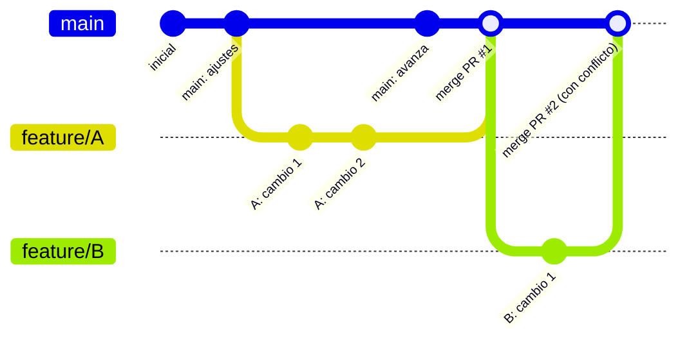

# Ramas y Pull Requests

Antes de usar los comandos, es importante entender dos conceptos clave de Git y GitHub: la **rama** y el **pull request**.

## ¿Qué es una rama (branch)?

Una rama es una línea de desarrollo independiente dentro del mismo repositorio. Cuando creas una rama, puedes modificar archivos, probar ideas o construir una funcionalidad sin afectar la rama principal (normalmente `main`). Cada commit que haces queda registrado solo en esa rama, hasta que decides integrarlo de vuelta.

Esto permite que varias personas trabajen en paralelo sobre el mismo proyecto, cada una en su propia rama, sin pisarse el trabajo entre sí.

## ¿Qué es un Pull Request (PR)?

Un Pull Request es una solicitud para integrar los cambios de una rama en otra (normalmente, de una rama de feature hacia `main`). El PR no mueve código por sí solo: es un espacio de revisión donde el equipo puede:

- Ver el diff de los cambios propuestos.
- Dejar comentarios línea por línea.
- Pedir ajustes antes de aprobar.
- Ejecutar automatizaciones (tests, linters, etc.) antes de permitir el merge.

Una vez aprobado, el PR se fusiona (*merge*) y los cambios pasan a formar parte de la rama destino.

## Cómo divergen y se fusionan las ramas

Cada rama parte de un punto común con `main` y avanza con sus propios commits. Si dos ramas tocan las mismas líneas de un mismo archivo, al fusionar la segunda aparecerá un **conflicto**: Git no sabe cuál versión del cambio debe prevalecer, y pide que una persona lo resuelva manualmente antes de completar el merge.
