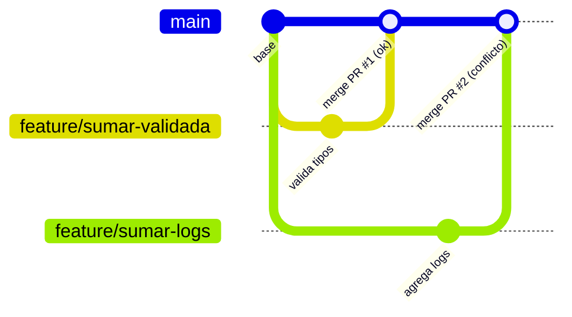
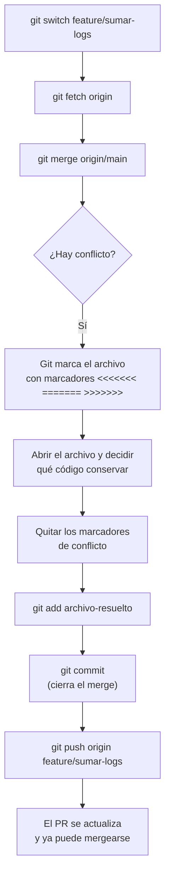
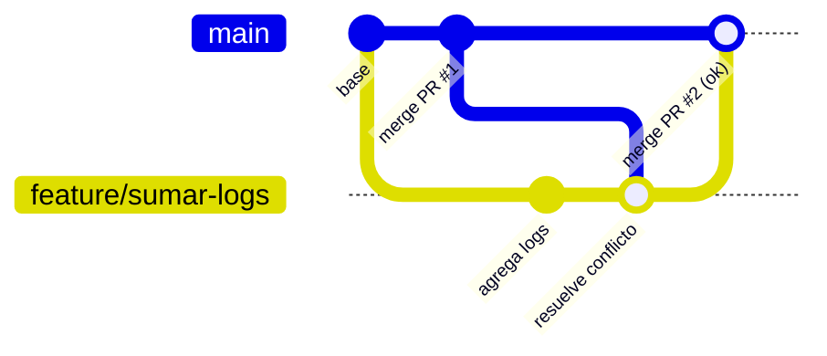

# Cómo resolver un conflicto de merge

Esta es la situación actual: la **PR #1** (`feature/sumar-validada`) ya se mergeó a `main`. La **PR #2** (`feature/sumar-logs`) sigue basada en el `main` viejo y modifica las mismas líneas de la función `sumar()`. Al intentar mergearla, Git no puede decidir solo qué versión dejar: aparece un **conflicto**.

## ¿Por qué pasa esto?



Las dos ramas partieron del mismo punto y tocaron la **misma función**. Git puede aplicar automáticamente cambios que no se superponen, pero cuando dos ramas editan las mismas líneas, necesita que una persona decida el resultado final.

## El flujo de resolución con `merge`

Elegimos `merge` (no `rebase`) porque `feature/sumar-logs` ya fue publicada como PR: queremos conservar el historial tal como ocurrió, sin reescribir commits que ya existen en el remoto.



## Qué vas a ver en el archivo en conflicto

Git deja el archivo con marcadores especiales que delimitan ambas versiones:

```python
def sumar(a, b):
<<<<<<< HEAD
    """Suma dos numeros e imprime el resultado para depuracion."""
    resultado = a + b
    print(f"sumar({a}, {b}) = {resultado}")
    return resultado
=======
    """Suma validando que los argumentos sean numéricos."""
    if not isinstance(a, (int, float)) or not isinstance(b, (int, float)):
        raise TypeError("sumar requiere numeros")
    return a + b
>>>>>>> origin/main
```

- Todo lo que está entre `<<<<<<< HEAD` y `=======` es **tu versión** (la rama en la que estás parado).
- Todo lo que está entre `=======` y `>>>>>>> origin/main` es **la versión entrante** (lo que ya está en `main`).

## Cómo decidir la resolución

En este caso, ambos cambios son válidos y no se excluyen: queremos **validar tipos** y, además, **dejar el log de depuración**. La resolución correcta no es "elegir un lado", sino **combinar la intención de ambos cambios**:

```python
def sumar(a, b):
    """Suma validando tipos e imprimiendo el resultado para depuracion."""
    if not isinstance(a, (int, float)) or not isinstance(b, (int, float)):
        raise TypeError("sumar requiere numeros")
    resultado = a + b
    print(f"sumar({a}, {b}) = {resultado}")
    return resultado
```

Después de editar el archivo:

1. Eliminar por completo los marcadores `<<<<<<<`, `=======` y `>>>>>>>`.
2. Guardar el archivo.
3. `git add` sobre el archivo resuelto, para decirle a Git que el conflicto quedó atendido.
4. `git commit` para cerrar el merge (Git ya deja un mensaje de commit sugerido tipo `Merge branch 'main' into feature/sumar-logs`).
5. `git push` para subir la resolución y que la PR #2 quede lista para mergear sin conflictos.

## Resultado final



El historial queda con ambas intenciones integradas, y queda registrado en el historial el commit de resolución del conflicto.
